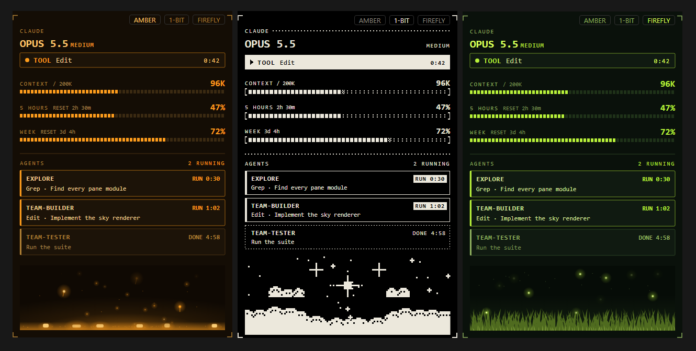

# claude-cockpit

A cockpit for Claude Code: a live pane with the model, phase, context and plan limits, your subagents and a calm animated scene; a token meter above the prompt; and a handoff skill that moves long work into a fresh session.




## What's inside

| Plugin | What it does |
|---|---|
| `bus` | The **BUS** pane. Model and effort, the current phase (thinking, tool, answering, idle) with the turn's timer, context against the auto-compact line, the 5-hour and weekly plan limits with reset times, a **HANDOFF NOW** alarm when the context is nearly full, and a card per subagent (running, done, failed). Under it a small scene that lives with the session: embers (amber), a dithered night sky where agents are sparks (1-bit), or fireflies over grass (firefly). |
| `token-meter` | A gauge above the prompt with the session's tokens, main loop and subagents, against round goals. |
| `handoff` | A skill that writes `HANDOFF.md` (goal, decisions, state, next steps) and gives you one block to paste into a new session, so nothing is lost when a chat gets long. |

Three styles, shared by `bus` and `token-meter`: **amber** (phosphor tube, the default), **1bit** (ink on black, every tone a dither) and **firefly** (lime on moss).

## Install

In Claude Code:

```
/plugin marketplace add Atall-dev/claude-cockpit
/plugin install bus@cockpit
/plugin install token-meter@cockpit
/plugin install handoff@cockpit
```

Or from a terminal:

```
claude plugin marketplace add Atall-dev/claude-cockpit
claude plugin install bus@cockpit
claude plugin install token-meter@cockpit
claude plugin install handoff@cockpit
```

If the installer says a `style` option is not set, you can skip it: the look defaults to amber and can be switched any time from the pane. Restart Claude Code (or reload the VS Code window) after installing. The pane is drawn as images, so it looks its best in the VS Code extension and the desktop app; in a terminal it falls back to text.

Update later with `claude plugin marketplace update cockpit`, then `claude plugin update <name>@cockpit` for each plugin.

## Use

- `/bus` opens the pane. `/bus style amber|1bit|firefly` switches the look of both plugins (no value: the next style). The three buttons in the pane's corner and `/config` do the same. `/bus clear` drops finished agents.
- `/tokens` prints the session's tokens in detail; `/tokens hide`, `/tokens show`, `/tokens reset`.
- Handoff, two ways:
  1. **As a plugin** (installed above): type `/handoff:handoff`, or just say "move this to a new chat"; Claude also starts it by itself when the context is filling up and the task is not finished.
  2. **As a personal skill**, for a bare `/handoff`: copy the skill into your skills folder.

     ```
     # macOS / Linux
     mkdir -p ~/.claude/skills/handoff
     curl -fsSL https://raw.githubusercontent.com/Atall-dev/claude-cockpit/main/plugins/handoff/skills/handoff/SKILL.md -o ~/.claude/skills/handoff/SKILL.md
     ```

     ```
     # Windows PowerShell
     New-Item -ItemType Directory -Force "$HOME\.claude\skills\handoff" | Out-Null
     Invoke-WebRequest https://raw.githubusercontent.com/Atall-dev/claude-cockpit/main/plugins/handoff/skills/handoff/SKILL.md -OutFile "$HOME\.claude\skills\handoff\SKILL.md"
     ```

     A skill is instructions for Claude: read the file before you copy it. Pick one way: with both, the skill shows up twice.

When the pane shows **HANDOFF NOW**, that is the moment to run the handoff.

## Performance

The status card is a still image, redrawn only when something changes (and every 5 s while a turn runs, for the timers). Motion lives only in the small scene under it, in stepped loops; the scene is cached, so the editor does not restart it on every redraw.

## Develop

```
claude plugin test plugins/bus
claude plugin test plugins/token-meter
```

`plugins/bus/concepts/` has preview scripts that render the whole pane or a strip of scene frames to PNG with headless Chrome (usage in each file's header).

## License

MIT
